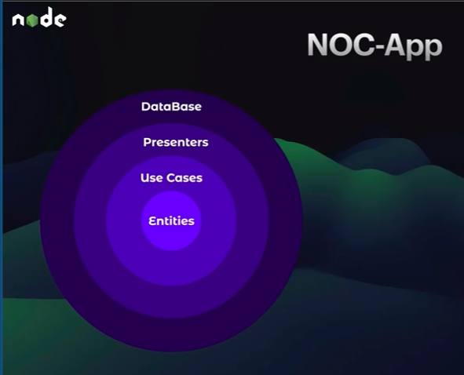
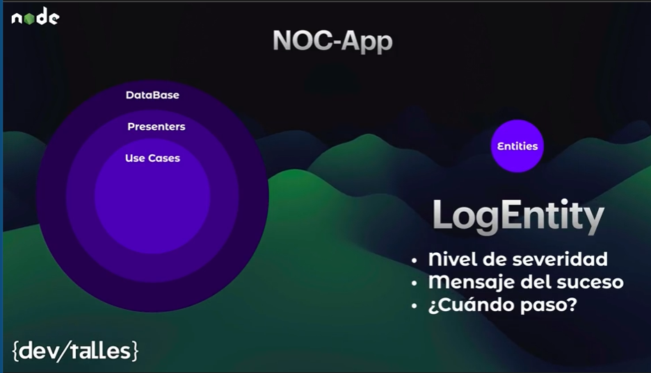
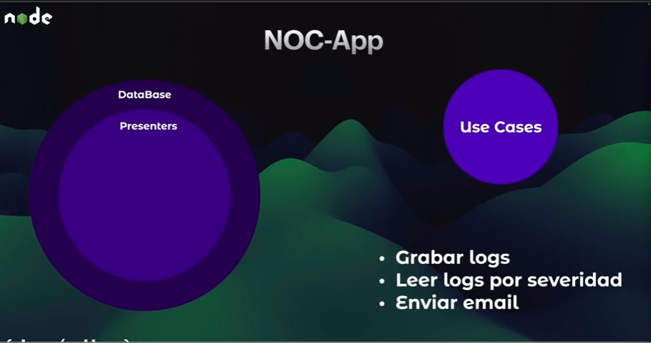
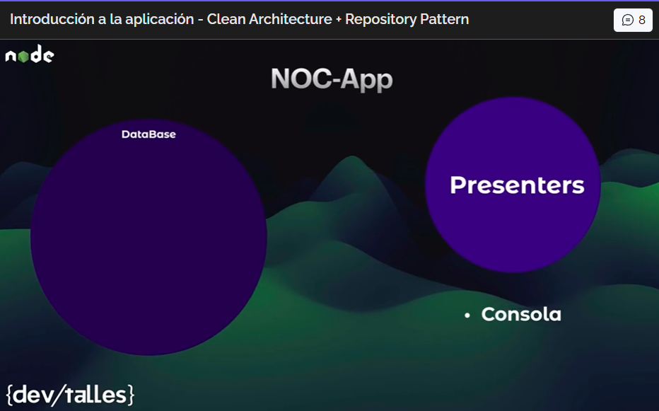
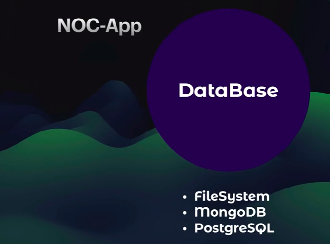
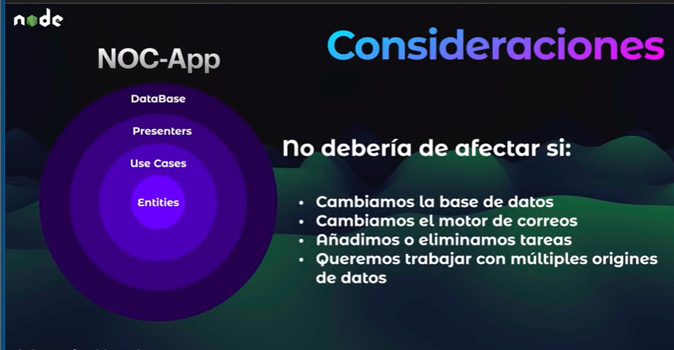
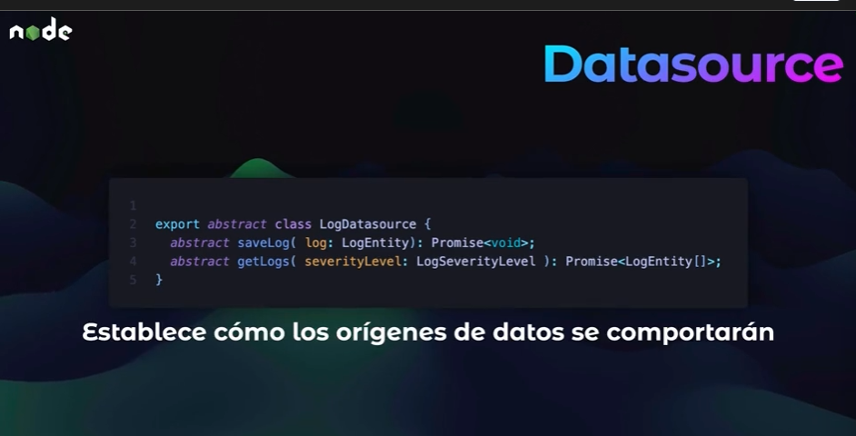
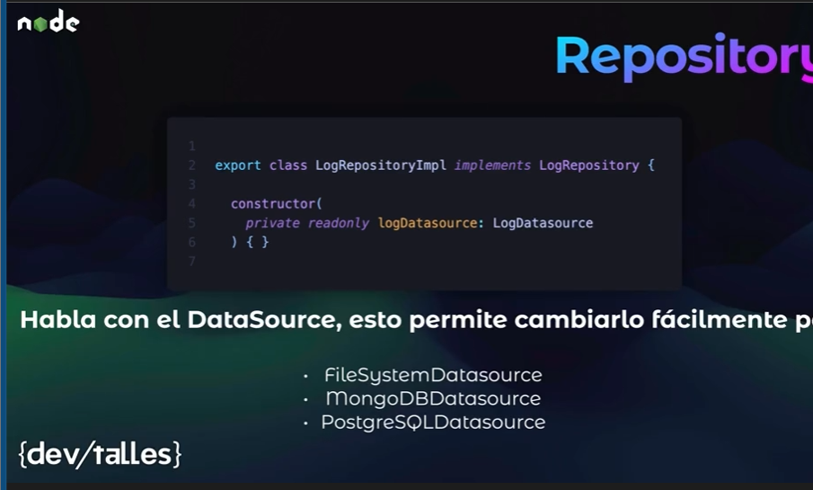
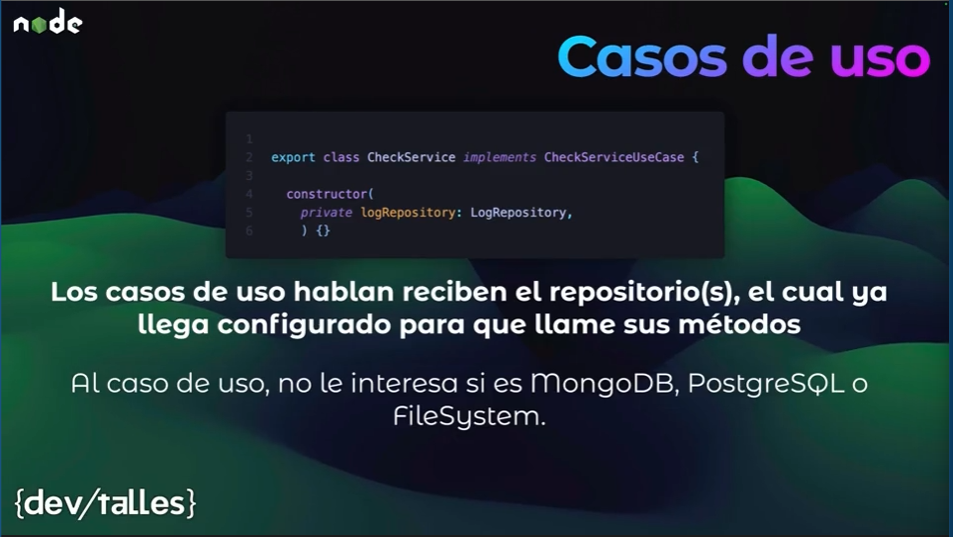

# Introduccion a la aplicacion - Clean Architecture + Repository Pattern

## NOC-App (Network Operation Center)

Es una app pendiente de servicios que necesita la empresa o que se estaran evaluando asi saber que esta bien o mal.

Ejecutar codigo en momentos especificos

- Por hora
- Al final del dia
- Todos los lunes
-Etc

`Este codigo sera un caso de uso`

Adicionalmente en la aplicacion que cubre esta seccion queremos que este monitoriando una API

Esto grabara logs de los sucesos.

Data Sources donde se grabaran los logs:

- fileSystem
- MongoDb
- PostgreSql

## Arquitectura limpia

### Entidades

Las entidades son la representacion de lo que se almacena en la base de datos.

Una entidad en programación es un objeto que representa algo importante del negocio o del sistema y que tiene una identidad propia.

### Casos de uso

Un Use Case contiene la lógica de aplicación necesaria para cumplir una tarea concreta del negocio.

### Presenter

La capa Presenter en Arquitectura Limpia se encarga de transformar la respuesta de los casos de uso en un formato adecuado para mostrarla al usuario o devolverla por una API.

### DataBase

Lugar donde se persiste o consulta nuestra informacion.

## Consideraciones

No deberia afectar nuestra aplicacion si:

- Cambiamos la base de datos
- Cambiamos el motor de correos
- Anadimos o eliminamos tareas
- Queremos trabajar con multiples origines de datos.

## Cómo lo logramos?

- Tenemos que crear mas archivos y directorios que en otras circunstancias no serian necesarios.

- Vamos a trabajar con un patron de repositorios

## Repository

El repositorio va a hablar con el origin de datos.

## Use cases

Los casos de usos tienen acceso al repositorio y este ya viene previamente configurado con el datasource que va usar , a los casos de usos no le importa que datasoruce se usa , lo que va a hacer es ejecutar las tareas

